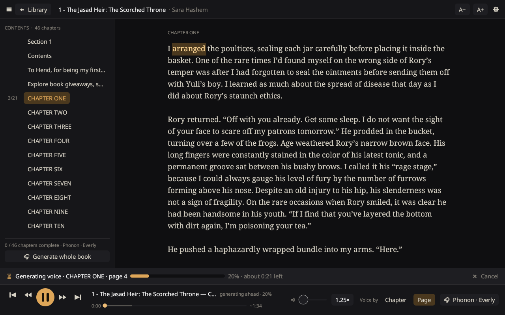
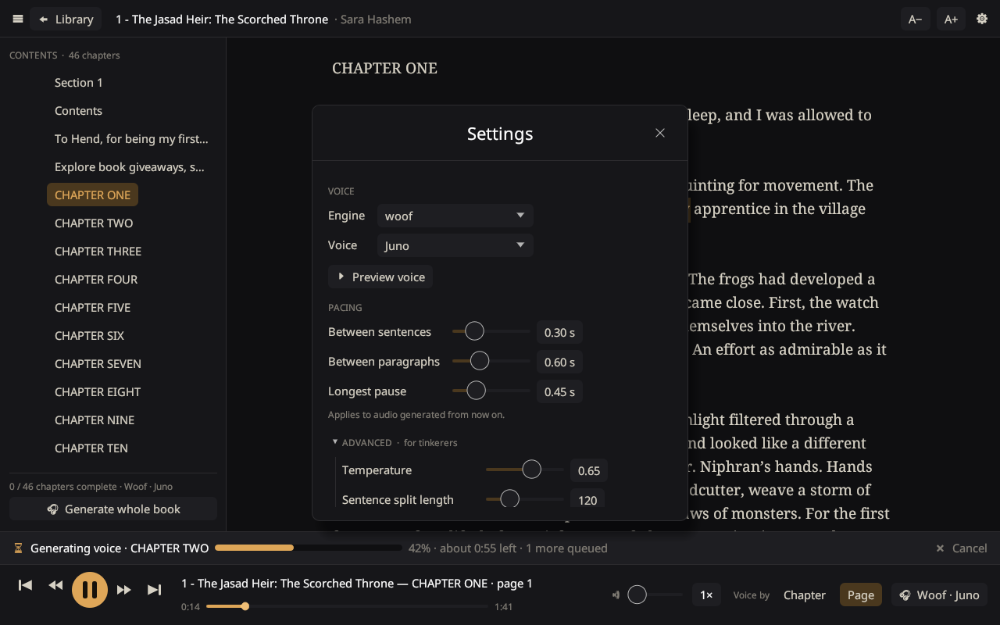

# InkVoice

A tiny, dark-mode ebook reader that turns your EPUB and PDF books into audiobooks — with small
text-to-speech models running entirely on your own machine. No cloud, no Electron, no PyTorch.



## Features

- **Native & light** — a single ~9 MB Rust binary (egui). Dark theme built for reading at night.
- **Library** with real cover art, reading progress, search, and every generated audio file per voice.
- **Read page by page or by chapter**, serif typography, adjustable size / spacing / width.
- **Listen per chapter or per page**, generated on your machine.
- **Streaming playback** — starts speaking a few seconds after you press play, from the page you are on,
  while the rest of the chapter is still being generated.
- **Follow-along** — the spoken word is highlighted and pages turn by themselves. Click any word to listen from there.
- **Speed control (0.5×–2.5×) without chipmunk pitch** (built-in WSOLA time-stretching).
- **Swappable voice engines**, each in its own process:

  | Engine | Size | Notes | License |
  |---|---|---|---|
  | [Phonon](https://gradium.ai/phonon) 31M | ~300 MB | 24 English voices, ~2–4× real time on CPU | Apache-2.0 |
  | [Kokoro](https://huggingface.co/hexgrad/Kokoro-82M) 82M (ONNX) | ~120 MB | 28 English voices (US/UK) | Apache-2.0 |
  | [Underdog Woof](https://huggingface.co/ConwayResearch/Underdog-Woof) | ~40 MB | 2 voices, numpy only | **Non-commercial** |

- **Natural pacing** — whole paragraphs per generation step, trimmed model silences, adjustable pauses.
- **Advanced settings** per engine (temperature, weights, sentence splitting, …) and *Regenerate audio* per chapter.
- Continuous play into the next chapter, pre-generation of the next chapter, generation queue with progress & ETA.

| Library | Settings |
|---|---|
|  |  |

## Install (Linux)

Requirements: Rust (stable), Python 3.10+, `curl`.

```sh
git clone https://github.com/sabeel111/InkVoice.git && cd InkVoice
./setup.sh                                  # Python venv + voice engines (~0.5 GB, no PyTorch)
cargo build --release
install -Dm755 target/release/bookreader ~/.local/bin/bookreader
install -Dm644 packaging/inkvoice.desktop ~/.local/share/applications/inkvoice.desktop
```

Then start **InkVoice** from your launcher, run `bookreader`, or `bookreader path/to/book.epub`.
Headless import: `bookreader --import book.epub`.

## Keyboard

| Key | Action |
|---|---|
| Space | Play / pause |
| ← / → | Previous / next page |
| Shift + ← / → | Back / forward 15 s |
| [ / ] | Slower / faster |
| Ctrl + O | Import a book |
| Ctrl + = / - | Text size |
| Ctrl + , | Settings |
| Esc | Back to library / close |

## How it works

```
src/main.rs      app state: library, queue, playback, streaming, follow-along
src/ui.rs        all drawing (library, reader, player bar, settings)
src/book.rs      EPUB/PDF import, pagination, covers, reading progress
src/player.rs    audio output, growing stream buffer, WSOLA speed change
src/tts.rs       talks to a voice worker over JSON lines (priority queue, cancel)
src/config.rs    settings, engines, voices, advanced parameters
workers/         Python voice workers — common.py does pacing, word timing and streaming
```

Each engine is a small worker process; the UI never links a model, so engines can be swapped,
added or removed without touching the app. Word timings are estimated by matching punctuation to the
pauses detected in the audio.

Data lives in `~/.local/share/bookreader` (books, audio, models, venv) and settings in
`~/.config/bookreader/config.json`.

## Model licenses

The models are downloaded by `setup.sh`, not stored in this repository. Underdog Woof is free for
non-commercial use only; Phonon (31M English) and Kokoro are Apache-2.0.
